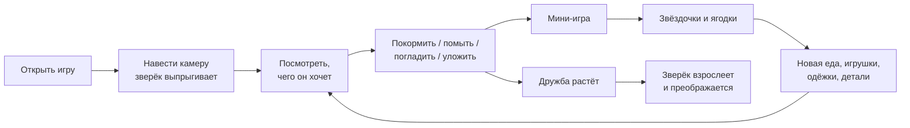

# Карманный зверёк — концепция игры

> Рабочее название. Настоящее имя игре (и виду зверька) лучше придумать вместе с дочкой.

## 1. Идея в одном предложении

Ребёнок собирает своего зверька из деталей, а потом наводит камеру телефона на пол или стол.
Зверёк появляется в комнате, живёт по-настоящему, как тамагочи: его надо кормить, мыть, укладывать спать и играть с ним.
А на прогулках он находит сюрпризы и новых друзей, как в Pokémon GO, только без сражений.

## 2. Для кого и главные принципы

Игра для одного ребёнка, то есть для дочки. Поэтому:

- **Зверёк никогда не умирает и не убегает.** Если про него забыли, он грустит, пачкается и засыпает. Когда ребёнок возвращается, зверёк радостно его встречает. Никакого чувства вины.
- **Без чтения.** Всё управление на крупных иконках, а обратная связь даётся звуками, анимацией, сердечками и искорками. Текст нужен только для имени.
- **Без рекламы, покупок, аккаунтов и интернета.** Все данные остаются на телефоне. Камера никуда не передаётся.
- **Короткие сессии по 5–15 минут.** Игра не тянет «играть ещё».
- **Родительский режим** спрятан за долгим нажатием или примером на сложение. В нём настраивается время сна, лимит игры в день и сброс.

## 3. Основной цикл

## 4. Конструктор зверька

Зверёк собирается из деталей, и каждую можно поменять в любой момент в «Салоне красоты».

| Деталь | Варианты (стартовый набор) |
|---|---|
| Форма тела | пухляш, шарик, стройняшка |
| Уши | большие лисьи, кошачьи, круглые мишкины, длинные заячьи, висячие |
| Хвост | пушистое облачко, лисий, тонкий кошачий, помпон, хвостик с кисточкой |
| Воротник или грива | пушистый воротник, гривка, нет |
| Глазки | круглые с бликами, огромные, сонные, «звёздочки» |
| Щёчки и нос | румянец, веснушки, нос-кнопка, нос-сердечко |
| Узор | без узора, пятнышки, полоски, кончики ушей и хвоста другого цвета |
| Цвета | основной, второй (живот, воротник, кончики), цвет глаз: палитра из 12–16 цветов |
| Аксессуары | бантик, шарфик, очки, шляпка, венок из цветов (открываются за звёздочки) |
| Голосок | высота и тип писка (тонкий, мурчащий, тявкающий) |
| Имя | вписывает ребёнок или родитель |

Стиль «чиби»: большая голова, огромные блестящие глаза, короткие лапки, мягкий мультяшный (toon) свет. Так он выглядит мило и не требует сложной графики.

### Про Иви

Иви принадлежит Nintendo и The Pokémon Company. Скопировать его или взять модель, вытащенную из их игр, мы не можем.
Зато можно сделать **своего** зверька в том же духе. Стартовый вариант «Пушистик»: лисо-котёнок с большими ушами, пушистым воротником и хвостом-облачком.
Остальное (цвета, уши, хвост) дочка выберет в конструкторе сама. Свой зверёк, придуманный ею, станет ей роднее.

Хорошая идея: попросить дочку нарисовать зверька на бумаге. Рисунок станет референсом для деталей и стартового набора.

## 5. Потребности

Четыре шкалы, каждая на своей иконке. Падают медленно: от полной до пустой примерно за 12–24 часа. Ночью, пока ребёнок спит, они «на паузе».

| Шкала | Иконка | Как восполнить | Что видно, когда низкая |
|---|---|---|---|
| Сытость | ягодка | покормить | урчит животик, смотрит на миску |
| Чистота | пузырёк | помыть | пятнышки грязи, вокруг летает муха-мультяшка |
| Радость | сердечко | погладить, поиграть | ушки опущены, вздыхает |
| Бодрость | луна | уложить спать | зевает, трёт глазки, медленно ходит |

Кроме шкал есть **Дружба**. Она только растёт: за любой уход, за каждый день, когда ребёнок заходит в игру, и за игры. От Дружбы зависит взросление.

## 6. Действия и взаимодействие в AR

**Появление.** Ребёнок наводит камеру на пол или стол, и там появляется светящийся кружок. Тап по кружку, и зверёк выпрыгивает из волшебного портала или яйца.

**Погладить.** Ребёнок водит пальцем по зверьку на экране. Зверёк жмурится, мурчит, и от него летят сердечки. Почесать за ушком и пузико означает разные реакции.

**Покормить.** Ребёнок тянет еду из меню к зверьку. Тот ловит её, жуёт и облизывается. У зверька есть любимая еда и нелюбимая: от нелюбимой он фыркает и отворачивается. Детям это очень смешно.

**Помыть.** Мытьё идёт в три шага:
1. Ребёнок трёт губкой, и зверёк покрывается пеной.
2. Включает душ, и пена смывается.
3. Вытирает полотенцем, а зверёк отряхивается с брызгами.

**Уложить спать.** Ребёнок ставит лежанку на пол и выключает «свет»: экран темнеет и появляются звёздочки. Зверёк сворачивается клубком и сопит.

**Живое поведение.** Именно оно создаёт ощущение, что зверёк живой:
- он следит глазами за телефоном и поворачивает голову к ребёнку;
- если поднести телефон очень близко, он удивляется, нюхает камеру и может лизнуть экран;
- сам гуляет по полу, садится, чешется, ловит свой хвост, зевает, моргает, дышит;
- от него на пол падает мягкая тень, без неё он будто «висит в воздухе»;
- утром он потягивается, вечером становится сонным (по реальному времени);
- по желанию: на громкий звук или хлопок поворачивает ушки и бежит к ребёнку (через микрофон, без записи).

**Фото.** Кнопка-фотоаппарат делает снимок с зверьком в комнате и сохраняет его в галерею телефона. Зверёк может позировать.

## 7. Мини-игры

Короткие, по 1–2 минуты, без проигрыша: просто больше или меньше звёздочек.

1. **Мячик.** Ребёнок свайпом кидает мяч по комнате, зверёк бежит и приносит его обратно.
2. **Мыльные пузыри.** Зверёк пускает пузыри, а ребёнок лопает их пальцем.
3. **Прятки.** Зверёк прячется где-то в комнате, и ребёнок ищет его, поворачиваясь с телефоном.
4. **Ягодный дождь.** Ребёнок двигает миску под падающие ягодки.
5. **Танцы.** Зверёк показывает движения (прыжок, кружок, лапкой), а ребёнок повторяет тапами по ритму.

## 8. Часть «как Pokémon GO»: прогулки и друзья

Без сражений и без «ловли в шарики». Вместо этого дружба.

- **Прогулка.** Ребёнок берёт зверька с собой на улицу с родителями. Шагомер считает шаги, и зверёк «находит» сюрпризы: шишки, ракушки, листочки, редкие ягоды. Это ресурсы для еды и украшений.
- **Сокровища в комнате.** Раз в день вокруг в AR прячутся 3–5 подарков. Их нужно найти, обойдя комнату.
- **Дикие зверята.** Иногда появляется стеснительный гость, другой зверёк. Если угостить его любимой едой и не спугнуть, он становится другом.
- **Альбом друзей.** Это коллекция всех встреченных зверят с их рисунками и пустыми местами «кто же тут будет?». Друзья иногда приходят в гости поиграть с питомцем.

Безопасность: на прогулке нет AR-режима, только шагомер. Иначе ребёнок будет ходить, глядя в экран. AR включается дома или на детской площадке под присмотром взрослого.

## 9. Взросление и преображения

Стадии роста зависят от Дружбы, а не только от времени, поэтому «проиграть» нельзя:

1. **Малыш** (первые дни): маленький, неуклюжий, много спит.
2. **Подросток** (около недели): подрастает, открываются новые игры.
3. **Взрослый** (около 2–3 недель): получает особое **преображение** в зависимости от того, что ребёнок делал чаще всего.

| Чаще всего… | Преображение | Как выглядит |
|---|---|---|
| играли | Радужный | разноцветные кончики шерсти, оставляет радужный след |
| кормили фруктами и ягодами | Садовый | цветочки на ушах, пахнет (искорки) клубникой |
| гладили и обнимали | Облачный | шёрстка как облако, маленькие крылышки-облачка |
| гуляли | Звёздный | звёздочки в шерсти, светится в темноте |

Преображение можно «примерять» и переключать после того, как оно открыто. Ребёнок не потеряет того зверька, которого любит.

## 10. Экономика

- **Звёздочки** дают за уход, мини-игры и ежедневный заход. На них покупают еду, игрушки и аксессуары.
- **Находки** (шишки, ракушки, ягоды) приносят с прогулок и тратят на особые угощения и украшения.
- Никаких реальных денег и никаких таймеров «подожди или заплати».

## 11. Техническая часть: варианты

**Телефон у дочки на Android**, значит, iPhone-ограничения нас не касаются.
Нужно только убедиться, что модель поддерживает ARCore (список: https://developers.google.com/ar/devices).

### Сравнение для Android

| | Веб (three.js + WebXR) | Unity + AR Foundation | Godot 4 |
|---|---|---|---|
| AR на телефоне | полноценный: Chrome сам использует ARCore (поверхности, свет, глубина) | полноценный, самый зрелый | слабое место: фокус Godot на XR-шлемах (OpenXR), для ARCore на телефоне есть только ранние сторонние плагины |
| Можно собирать и проверять в облачной сессии | да, целиком | только писать код, собирать на своём ПК | экспорт APK возможен, но AR-часть сырая |
| Установка на телефон | открыть ссылку, «Добавить на главный экран» | APK по USB | APK по USB |
| Скорость правок | обновил страницу, и готово | пересборка APK | пересборка APK |
| Главный минус | шагомер работает, только пока игра открыта | тяжёлый редактор, долгие сборки | AR придётся «допиливать» самим |

**Выбор: веб.** Godot отлично подходит для 2D- и 3D-игр и для VR-шлемов, но AR на телефоне в нём пока сырой.
Unity даёт надёжный AR, но требует компьютера и долгих сборок, при этом на Android выигрыш по сравнению с вебом небольшой.

### Вариант A. Веб-приложение (three.js + WebXR, PWA), выбран

Игра открывается по ссылке и добавляется на главный экран как обычная иконка. Хостинг бесплатный (GitHub Pages).
Её можно целиком писать, собирать и проверять прямо здесь.

- **Android** (Chrome и телефон с поддержкой ARCore): настоящий AR. Зверёк стоит на полу или столе, его можно обходить.
- **iPhone:** Safari до сих пор не поддерживает WebXR AR (проверено на ноябрь 2026). Запасные режимы:
  - **«Волшебная карточка»**: распечатанная карточка-домик, на которой появляется зверёк (трекинг по картинке, работает и на iPhone). Для ребёнка это даже интереснее, потому что у зверька есть свой «домик», который можно потрогать.
  - **Камера + гироскоп**: зверёк на фоне камеры, но без точной привязки к полу.

### Вариант B. Unity + AR Foundation

Настоящий AR и на iPhone (ARKit), и на Android (ARCore), лучшая графика, нативное приложение.
Минусы: нужен компьютер с Unity. Для iPhone нужен ещё Mac с Xcode, а бесплатная подпись разработчика живёт 7 дней, после этого приложение нужно переустанавливать.
Код можно писать здесь, но собирать и ставить на телефон придётся у себя.

### Вариант C. Нативное iOS-приложение (Swift + RealityKit)

Лучший AR на iPhone, но только iPhone, и тоже нужен Mac.

**Рекомендация:** начать с варианта A. Он даёт самый быстрый путь «увидеть зверька на телефоне» уже на первом этапе.
Если телефон на iPhone и захочется полноценный AR на полу, позже можно перенести готовую логику и дизайн в Unity.

### 3D-модель зверька

- **Собираем из деталей прямо в коде.** Мягкие формы (сферы, капсулы, конусы со сглаживанием) и toon-шейдинг.
  Это идеально подходит для конструктора: каждая деталь отдельная, цвета меняются на лету.
  Анимации тоже процедурные: дыхание, моргание, ушки, хвост, прыжки. Сложный риггинг не нужен.
- **Улучшения позже:**
  - детали, смоделированные в Blender (можно генерировать скриптом в GLB);
  - модели, сгенерированные ИИ-сервисами (Meshy, Tripo) по описанию нашего зверька;
  - для диких зверят можно взять бесплатные CC0-паки (например, Quaternius).
- Звуки: короткие писки, мурчание, чавканье. Бесплатные CC0-звуки или запись своими голосами, что тоже весело делать вместе с дочкой.

## 12. План по этапам

| Этап | Что получаем |
|---|---|
| 0. Прототип | Зверёк на экране (без AR): собран из деталей, дышит, моргает, реагирует на поглаживание |
| 1. Конструктор | Экран сборки: детали, цвета, имя. Сохранение на телефоне |
| 2. AR | Зверёк появляется на полу, столе или карточке, смотрит на ребёнка, ходит, отбрасывает тень |
| 3. Тамагочи | 4 шкалы, кормление, мытьё, сон, реальное время, ночная пауза |
| 4. Игры и награды | 2–3 мини-игры, звёздочки, магазин аксессуаров, фото |
| 5. Прогулки и друзья | Шагомер, находки, дикие зверята, альбом друзей |
| 6. Взросление | Стадии роста и преображения |
| 7. Родительский режим | Время сна, лимиты, сброс |

Каждый этап — это рабочая версия, которую можно сразу дать дочке и посмотреть, что ей нравится.

## 13. Открытые вопросы

1. **Телефон:** Android. Какая модель? Нужно проверить поддержку ARCore.
2. **Возраст дочки:** читает ли она уже? От этого зависят интерфейс и сложность мини-игр.
3. **Компьютер:** есть ли Mac или Windows с возможностью поставить Unity? Это нужно только для вариантов B и C.
4. **Язык и голос:** интерфейс на русском. Нужна ли озвучка подсказок голосом?
5. **Название** игры и вида зверька придумываем с дочкой.
